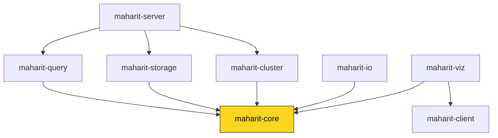

# MaharitDB

[English](README.md) | 日本語

Rust で実装されたグラフデータベースエンジンです。Cypher ライクなクエリ言語による直感的なグラフ操作と、本番環境向けのサーバー機能を提供します。

[](https://github.com/Moto1829/maharit-db/actions/workflows/test.yml)
[](Cargo.toml)
[](rust-toolchain.toml)

## 特徴

- **Cypher ライクなクエリ言語** — `MATCH`、`CREATE`、`MERGE`、`DELETE`、`UNWIND`、`WITH`、`UNION`、`FOREACH`、`CALL {}` サブクエリ、`$param` パラメータをサポート
- **BM25 全文検索** — フレーズ検索・ファジー検索に対応。日本語形態素解析（lindera IPADIC）は `japanese` feature を有効にしてビルドした場合に利用可能
- **インデックス・制約** — プロパティインデックス、UNIQUE / NOT NULL / 型 / 複合 UNIQUE 制約
- **グラフアルゴリズム** — PageRank、最短経路（Dijkstra / A* / BFS）、媒介中心性、近接中心性、連結成分、強連結成分、サイクル検出、トポロジカルソート
- **永続化** — 1 ファイルのデータファイルに保存（停止時に保存）。Write-Ahead Log（グループコミット対応）は `maharit-storage` の API で利用可能（サーバーはまだディスク上の WAL を書かない）
- **TLS/SSL 対応** — rustls による TLS 1.2/1.3、証明書ホットリロード
- **認証・RBAC** — ユーザー管理とロールベースアクセス制御（admin / writer / reader）
- **細粒度 ACL** — ラベル・プロパティ単位のアクセス権限制御
- **Prometheus メトリクス** — `/metrics`、`/health` エンドポイントで監視基盤と連携
- **OpenTelemetry トレーシング** — クエリ実行経路の分散トレーシング
- **レプリケーション** — WAL ストリーミングによるリーダー/フォロワー構成とフェイルオーバー
- **バックアップ・リストア** — gzip / zstd 圧縮、増分バックアップ
- **クライアント** — 非同期 Rust クライアント（tokio、コネクションプール、同期 API あり）と [Python クライアント](clients/python/)
- **可視化** — DOT / SVG / ASCII 出力と、ブラウザでクエリ結果をテーブル・グラフ表示する Web アプリ（`maharit-viz`）

## ドキュメント

**https://moto1829.github.io/maharit-db/** — クエリ言語リファレンス・関数リファレンス・運用ガイド・API リファレンス（MkDocs、ソースは [`docs/`](docs/)）。英語版は準備中です。

## インストール

### ビルド済みバイナリ

Linux / macOS（x86_64・aarch64）と Windows（x86_64）向けのバイナリを [GitHub Releases](https://github.com/Moto1829/maharit-db/releases) で配布します（v0.2.0 以降）。

```bash
# Linux / macOS
curl -fsSL https://raw.githubusercontent.com/Moto1829/maharit-db/main/install.sh | bash
```

```powershell
# Windows (PowerShell)
irm https://raw.githubusercontent.com/Moto1829/maharit-db/main/install.ps1 | iex
```

### ソースからビルド

Rust ツールチェーンが必要です。バージョンは [`rust-toolchain.toml`](rust-toolchain.toml) で固定されており、rustup が自動で取得します。

```bash
git clone https://github.com/Moto1829/maharit-db.git
cd maharit-db
cargo build --release -p maharit-server   # target/release/maharit

# 日本語形態素解析付き（IPADIC 辞書を埋め込むためバイナリが大きくなります）
cargo build --release -p maharit-server --features japanese
```

## クイックスタート

### REPL（対話モード）

```bash
maharit            # ソースから実行する場合: cargo run -p maharit-server
```

```text
maharit> CREATE (alice:Person {name: "Alice", age: 30})
created_nodes | created_edges
--------------------------------
1 | 0

1 row(s) returned
maharit> CREATE (bob:Person {name: "Bob", age: 25})
...
maharit> MATCH (a:Person {name: "Alice"}), (b:Person {name: "Bob"}) CREATE (a)-[:KNOWS {since: 2020}]->(b)
created_nodes | created_edges
--------------------------------
0 | 1

1 row(s) returned
maharit> MATCH (n:Person) RETURN n.name, n.age ORDER BY n.name
n.name | n.age
-----------------
"Alice" | 30
"Bob" | 25

2 row(s) returned
```

`:help` でコマンド一覧、`:quit` で終了します。

### TCP サーバー

```bash
# デフォルト設定で起動（127.0.0.1:7687、データファイルは ./maharit.db）
maharit server

# すべてのインタフェースにバインドし、データファイルを指定
maharit server --host 0.0.0.0 --port 7687 --data /var/lib/maharit/maharit.db
```

その他のサブコマンド（`backup` / `restore` / `admin`）とオプションは `maharit --help` を参照してください。

### Docker

```bash
docker-compose up -d
```

TCP サーバー（`localhost:7687`）と Web 可視化アプリ（http://localhost:8080 ）が起動します。

### Rust クライアント

```rust
use maharit_client::Client;

#[tokio::main]
async fn main() -> Result<(), Box<dyn std::error::Error>> {
    let mut client = Client::connect("127.0.0.1:7687").await?;

    client.execute("CREATE (n:Person {name: \"Alice\", age: 30})").await?;

    let result = client.query("MATCH (n:Person) RETURN n.name, n.age").await?;
    for row in &result.rows {
        println!("{:?}", row);
    }

    Ok(())
}
```

## クレート構成

MaharitDB は 8 個のクレートからなる Cargo workspace です。`maharit-core` を基盤に各クレートが構築されています。

| クレート | 説明 |
|---------|------|
| `maharit-core` | グラフデータ構造・アルゴリズム・全文検索エンジン・制約 |
| `maharit-query` | Cypher クエリのレキサー・パーサー・プランナー・エグゼキュータ |
| `maharit-storage` | WAL・永続化・MVCC トランザクション・バックアップ |
| `maharit-cluster` | シャーディング・ルーティング戦略 |
| `maharit-server` | バイナリ `maharit`（REPL・TCP サーバー・認証・メトリクス・レプリケーション） |
| `maharit-client` | 非同期/同期クライアント・コネクションプール |
| `maharit-io` | CSV / JSON / GraphML インポート・エクスポート |
| `maharit-viz` | DOT / SVG / ASCII 可視化・Web 可視化アプリ |

### クレート依存関係



- `maharit-core` は他のどのクレートにも依存しない基盤クレートです。
- `maharit-client` は独立した tokio TCP クライアントで、`maharit-core` には依存しません（`maharit-viz` からのみ利用）。
- `maharit-server` はバイナリ `maharit` を生成するエントリポイントで、`query` / `storage` / `cluster` を統合します。

## グラフアルゴリズム（Rust API）

```rust
use maharit_core::{
    Dijkstra, Graph, PageRankConfig, betweenness_centrality, connected_components, pagerank,
};

let graph = Graph::new();
// ... ノードとエッジを追加 ...

let scores     = pagerank(&graph, &PageRankConfig::default());
let path       = Dijkstra::with_weight_property(&graph, "weight").find_path(source_id, target_id);
let centrality = betweenness_centrality(&graph);
let components = connected_components(&graph);
```

## データの入出力

```rust
use maharit_io::{CsvImporter, JsonExporter};

// CSV からインポート
let stats = CsvImporter::import_nodes(&mut graph, nodes_csv)?;
CsvImporter::import_edges(&mut graph, edges_csv, &stats.id_map)?;

// JSON へエクスポート
JsonExporter::export(&graph, writer)?;
```

## 変更履歴

[CHANGELOG.md](CHANGELOG.md) を参照してください。バージョンは [Semantic Versioning](https://semver.org/lang/ja/) に従います。

## ライセンス

MIT License
