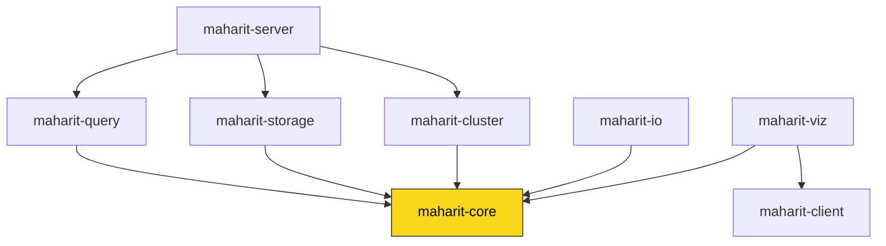

# MaharitDB

English | [日本語](README.ja.md)

A graph database engine written in Rust. It offers intuitive graph operations through a Cypher-like query language, plus the server features you need in production.

[](https://github.com/Moto1829/maharit-db/actions/workflows/test.yml)
[](Cargo.toml)
[](rust-toolchain.toml)

## Features

- **Cypher-like query language** — `MATCH`, `CREATE`, `MERGE`, `DELETE`, `UNWIND`, `WITH`, `UNION`, `FOREACH`, `CALL {}` subqueries, and `$param` parameters
- **BM25 full-text search** — phrase and fuzzy search. Japanese morphological analysis (lindera IPADIC) is available when built with the `japanese` feature
- **Indexes and constraints** — property indexes; UNIQUE, NOT NULL, type, and composite UNIQUE constraints
- **Graph algorithms** — PageRank, shortest paths (Dijkstra / A* / BFS), betweenness centrality, closeness centrality, connected components, strongly connected components, cycle detection, and topological sort
- **Durability with a WAL** — every write is appended to a write-ahead log (fsync with group commit) before the reply and replayed after a crash; checkpoints into a single data file
- **TLS/SSL** — TLS 1.2/1.3 via rustls, with certificate hot reload
- **Authentication and RBAC** — user management and role-based access control (admin / writer / reader)
- **Fine-grained ACLs** — access control per label and per property
- **Prometheus metrics** — `/metrics` and `/health` endpoints for your monitoring stack
- **OpenTelemetry tracing** — distributed tracing of query execution
- **Replication** — leader/follower setup with WAL streaming and failover
- **Backup and restore** — gzip / zstd compression and incremental backups
- **Clients** — an async Rust client (tokio, connection pooling, plus a blocking API) and a [Python client](clients/python/)
- **Visualization** — DOT / SVG / ASCII output, and a web app (`maharit-viz`) that shows query results as tables and graphs in the browser

## Documentation

**https://moto1829.github.io/maharit-db/** — query language reference, function reference, operations guide, and API reference (MkDocs; sources in [`docs/`](docs/)). The documentation is currently in Japanese; an English translation is in progress.

## Installation

### Prebuilt binaries

Binaries for Linux / macOS (x86_64 and aarch64) and Windows (x86_64) are published on [GitHub Releases](https://github.com/Moto1829/maharit-db/releases) (v0.2.0 and later).

```bash
# Linux / macOS
curl -fsSL https://raw.githubusercontent.com/Moto1829/maharit-db/main/install.sh | bash
```

```powershell
# Windows (PowerShell)
irm https://raw.githubusercontent.com/Moto1829/maharit-db/main/install.ps1 | iex
```

### Building from source

You need a Rust toolchain. The version is pinned in [`rust-toolchain.toml`](rust-toolchain.toml), and rustup fetches it automatically.

```bash
git clone https://github.com/Moto1829/maharit-db.git
cd maharit-db
cargo build --release -p maharit-server   # target/release/maharit

# With Japanese morphological analysis (embeds the IPADIC dictionary, so the binary is larger)
cargo build --release -p maharit-server --features japanese
```

## Quick start

### REPL (interactive mode)

```bash
maharit            # from source: cargo run -p maharit-server
```

```text
maharit> CREATE (alice:Person {name: "Alice", age: 30})
created_nodes | created_edges
--------------------------------
1 | 0

1 row(s) returned
maharit> CREATE (bob:Person {name: "Bob", age: 25})
...
maharit> MATCH (a:Person {name: "Alice"}), (b:Person {name: "Bob"}) CREATE (a)-[:KNOWS {since: 2020}]->(b)
created_nodes | created_edges
--------------------------------
0 | 1

1 row(s) returned
maharit> MATCH (n:Person) RETURN n.name, n.age ORDER BY n.name
n.name | n.age
-----------------
"Alice" | 30
"Bob" | 25

2 row(s) returned
```

Type `:help` for the list of commands and `:quit` to exit.

### TCP server

```bash
# Start with the defaults (127.0.0.1:7687, data file ./maharit.db)
maharit server

# Bind to all interfaces and choose the data file
maharit server --host 0.0.0.0 --port 7687 --data /var/lib/maharit/maharit.db
```

See `maharit --help` for the other subcommands (`backup` / `restore` / `admin`) and options.

### Docker

```bash
docker-compose up -d
```

This starts the TCP server (`localhost:7687`) and the visualization web app (http://localhost:8080).

### Rust client

```rust
use maharit_client::Client;

#[tokio::main]
async fn main() -> Result<(), Box<dyn std::error::Error>> {
    let mut client = Client::connect("127.0.0.1:7687").await?;

    client.execute("CREATE (n:Person {name: \"Alice\", age: 30})").await?;

    let result = client.query("MATCH (n:Person) RETURN n.name, n.age").await?;
    for row in &result.rows {
        println!("{:?}", row);
    }

    Ok(())
}
```

## Crates

MaharitDB is a Cargo workspace of eight crates, all built on top of `maharit-core`.

| Crate | Description |
|---------|------|
| `maharit-core` | Graph data structures, algorithms, full-text search engine, constraints |
| `maharit-query` | Cypher lexer, parser, planner, and executor |
| `maharit-storage` | WAL, persistence, MVCC transactions, backups |
| `maharit-cluster` | Sharding and routing strategies |
| `maharit-server` | The `maharit` binary (REPL, TCP server, authentication, metrics, replication) |
| `maharit-client` | Async/blocking client and connection pool |
| `maharit-io` | CSV / JSON / GraphML import and export |
| `maharit-viz` | DOT / SVG / ASCII visualization and the visualization web app |

### Crate dependencies



- `maharit-core` is the foundation crate and depends on no other crate in the workspace.
- `maharit-client` is a standalone tokio TCP client that does not depend on `maharit-core` (only `maharit-viz` uses it).
- `maharit-server` is the entry point that builds the `maharit` binary and ties together `query`, `storage`, and `cluster`.

## Graph algorithms (Rust API)

```rust
use maharit_core::{
    Dijkstra, Graph, PageRankConfig, betweenness_centrality, connected_components, pagerank,
};

let graph = Graph::new();
// ... add nodes and edges ...

let scores     = pagerank(&graph, &PageRankConfig::default());
let path       = Dijkstra::with_weight_property(&graph, "weight").find_path(source_id, target_id);
let centrality = betweenness_centrality(&graph);
let components = connected_components(&graph);
```

## Import and export

```rust
use maharit_io::{CsvImporter, JsonExporter};

// Import from CSV
let stats = CsvImporter::import_nodes(&mut graph, nodes_csv)?;
CsvImporter::import_edges(&mut graph, edges_csv, &stats.id_map)?;

// Export to JSON
JsonExporter::export(&graph, writer)?;
```

## Changelog

See [CHANGELOG.md](CHANGELOG.md) (currently in Japanese). Versions follow [Semantic Versioning](https://semver.org/).

## License

MIT License
