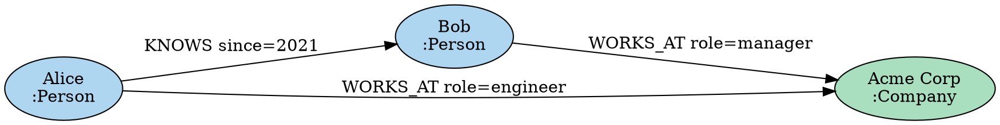

# DOT / SVG export

The `maharit-viz` crate exports a graph to the Graphviz DOT format and to SVG.

## DOT export

DOT is the standard graph description language that Graphviz renders.

Export with the Rust API of the `maharit-viz` crate (it writes out a whole `Graph`). To view Cypher query results as a diagram in the browser, use the [web app](web-app.md). There is no export procedure callable from Cypher.

### Exporting from the Rust API

```rust
use maharit_viz::{DotExporter, DotStyle};
use maharit_core::Graph;
use std::fs;

fn main() -> std::io::Result<()> {
    let graph = Graph::new(); // Build the graph...

    // Export with the default style (a static method)
    let dot = DotExporter::export(&graph);

    // Save to a file
    fs::write("graph.dot", &dot)?;
    println!("Exported to graph.dot");

    Ok(())
}
```

To customize the style, build a `DotStyle` and use `export_with_style`:

```rust
use maharit_viz::{DotExporter, DotStyle};
use maharit_core::Graph;

fn main() -> std::io::Result<()> {
    let graph = Graph::new(); // Build the graph...

    let style = DotStyle {
        top_to_bottom: false,    // Draw left to right
        node_shape: "box".to_string(),
        node_color: "lightyellow".to_string(),
        edge_color: "black".to_string(),
        show_properties: true,
        max_properties: 5,
    };

    let dot = DotExporter::export_with_style(&graph, &style);
    std::fs::write("graph.dot", &dot)?;

    Ok(())
}
```

### Example DOT file



### Rendering with Graphviz

```bash
# Convert to PNG
dot -Tpng graph.dot -o graph.png

# Convert to SVG
dot -Tsvg graph.dot -o graph.svg

# Convert to PDF
dot -Tpdf graph.dot -o graph.pdf

# Use a different layout engine
neato -Tsvg graph.dot -o graph_neato.svg  # Force-directed
circo -Tsvg graph.dot -o graph_circo.svg  # Circular
```

## SVG export

MaharitDB can generate SVG directly, without Graphviz. Nodes are placed with a force-directed layout.

### SVG export from the Rust API

```rust
use maharit_viz::{SvgExporter, ForceDirectedLayout};
use maharit_core::Graph;

fn main() -> std::io::Result<()> {
    let graph = Graph::new(); // Build the graph...

    // Export with the default settings
    let exporter = SvgExporter::default();
    let svg = exporter.export(&graph);

    std::fs::write("graph.svg", &svg)?;
    println!("SVG exported to graph.svg");

    Ok(())
}
```

### Customizing the SVG

Customize by setting the fields of `SvgExporter` and `ForceDirectedLayout` directly:

```rust
use maharit_viz::{SvgExporter, ForceDirectedLayout};
use maharit_core::Graph;

fn main() -> std::io::Result<()> {
    let graph = Graph::new(); // Build the graph...

    let exporter = SvgExporter {
        layout: ForceDirectedLayout {
            iterations: 300,        // More iterations for a more stable layout
            repulsion: 1000.0,      // Repulsion between nodes
            attraction: 0.05,       // Attraction along edges
            damping: 0.9,           // Velocity damping factor
            canvas_width: 1200.0,   // Canvas width (pixels)
            canvas_height: 900.0,   // Canvas height (pixels)
        },
        node_radius: 25.0,
        node_color: "#3498DB".to_string(),
        edge_color: "#E74C3C".to_string(),
        font_size: 14.0,
    };

    // Write directly to a file
    exporter.export_to_file(&graph, "graph.svg")?;

    Ok(())
}
```
